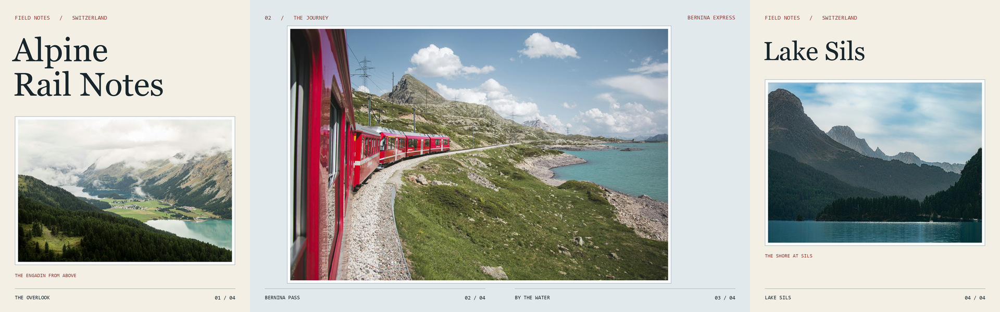

# SwipeSpread

An agent skill for designing seamless 4:5 Instagram photo and video carousels. See [SKILL.md](SKILL.md) for the workflow.

## What it can do

- **Choose a lead.** Tell the agent who to feature on the cover and at key moments. If several people could be the lead and you haven't picked one, the agent asks before finalizing the selection.
- **Trim video for the carousel.** Give the agent a time range or let it pick the strongest moments from a longer clip. It fits those excerpts into the same 4:5 layout as the photos.

## Example · Alpine Rail Notes

Pages **02 and 03** share one photograph. The seam sits beyond the train so the track and lakeshore carry the eye from one slide into the next. The opening and closing photos keep their original framing inside warm white borders.

**Individual 1080 × 1350 slides:** [01 · Cover](examples/alpine-rail-notes/01.jpg) · [02 · Left](examples/alpine-rail-notes/02.jpg) · [03 · Right](examples/alpine-rail-notes/03.jpg) · [04 · Closing](examples/alpine-rail-notes/04.jpg)

### Photo credits

- Engadin overlook by [Mike Dennler](https://unsplash.com/photos/forest-top-view-during-daytime-93KTLDGoFQw)
- Bernina Express by [Sara Groblechner](https://unsplash.com/photos/red-train-near-lake-D5aHNDl9jGA)
- Lake Sils by [Christopher Politano](https://unsplash.com/photos/lake-and-pine-forest-mountain-landscape-fguTSQeKvDE)

The photos are used under the [Unsplash License](https://unsplash.com/license).
